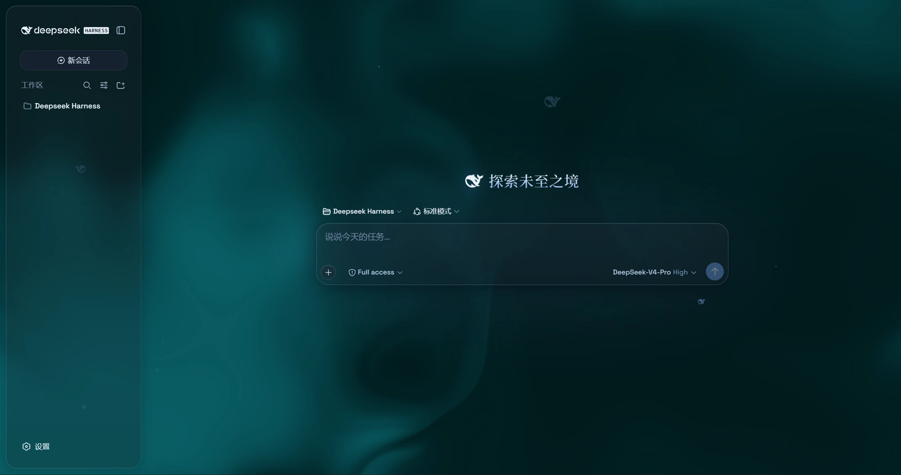
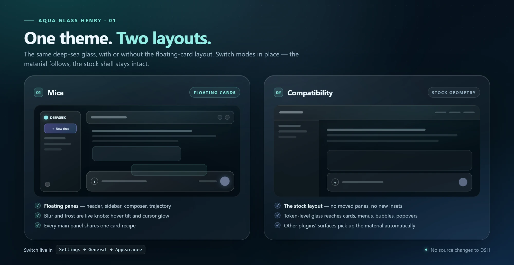
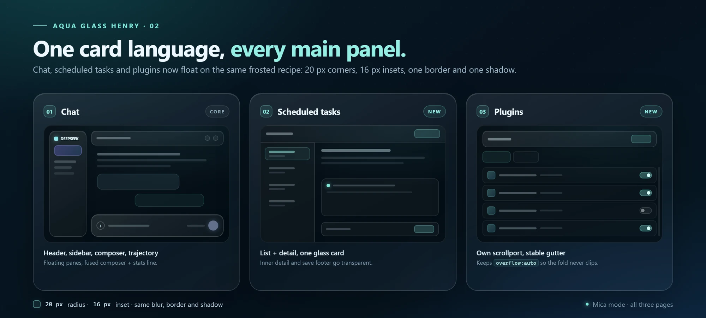
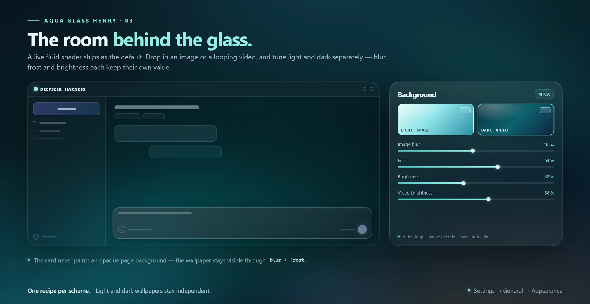
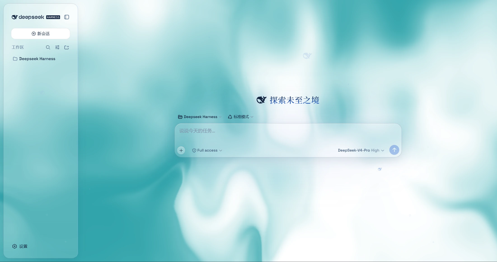

# Driftglass

English | [中文](README.md)

**Deep-sea glass for the DeepSeek Harness desktop and web UI.** Driftglass turns the shell into floating frosted panes over a living fluid backdrop — or over your own image or video wallpaper. It is a plugin: DSH's source stays untouched, and one switch puts the stock interface back.

<p align="center">
  
  
  
  
  <a href="https://github.com/deepseek-ai/deepseek-harness"></a>
</p>

<p align="center">
  
</p>

*Screenshots are from this project. DSH's own copy follows your locale.*

Driftglass is the fork of [WYH66666666's Aqua v1.3.0](https://github.com/WYH66666666/DSH-Transparent-UI-Plugin) rebuilt for **DSH 0.2.2-rc.1**. The original material system is still here. The fork carries it into the current Harness: a package that installs, a backdrop that reaches the page edge, one card language on all three main panels, and wallpapers that can follow light and dark separately.

## What this fork changes

| Area | Since the v1.3.0 baseline |
| --- | --- |
| **DSH 0.2.2-rc.1** | Rebuilt for the redesigned General settings (the row sits right after Font size) and the new right workbench, which now shares the same glass card; installation and the theme switch are covered by regression tests. |
| **Desktop backdrop** | The opaque center column is gone: the fluid or wallpaper now reaches the page edge behind the floating cards. |
| **Main panels** | Scheduled tasks and the plugin manager join the floating-card family. The plugin page keeps its own scrollport and a stable scrollbar gutter. |
| **Wallpapers** | Light and dark each keep their own image or video, plus their own blur, frost and brightness. |
| **Video** | Loads survive theme and background switches, stale async loads are dropped, an already-authorized file can be replaced, and the data-URL fallback keeps the video format. |
| **Windows chrome** | Titlebar controls stay anchored, transcript text clears the floating header, and the sidebar column no longer tilts. |
| **Type and details** | A serif CJK face with Space Grotesk for Latin, a white cursor glow, blue checked switches, real glass on the slash-command popover, and sidebar glass aligned with the cards. |
| **Multi-window** | Theme, wallpaper and ambience settings stay in sync across windows. |

## Two layouts, one material

<p align="center">
  
</p>

Switch modes live in **Settings → General → Appearance**; no restart is needed.

| | Mica | Compatibility |
| --- | --- | --- |
| **Layout** | Floating cards: 20px corners, 16px inset around the shell | Stock geometry: no moved panes, no new insets |
| **Material** | The full frosted-pane recipe over the backdrop | Token-level glass applied to the stock layout |
| **Coverage** | Header, sidebar, composer + stats, trajectory, and all three main panels | Cards, menus, bubbles, popovers, toasts, the settings panel, and third-party plugin surfaces |
| **Extras** | Hover tilt and cursor glow | Conservative blur on menus, cards, bubbles, popovers, and panels |

Mica is the full treatment. Compatibility is the escape hatch for a layout-sensitive day, or for plugins that expect the stock shell.

## One card language

<p align="center">
  
</p>

All three main panels share one recipe: **20px corners, a 16px inset, a hairline border, an inset top highlight, a soft drop shadow, and backdrop blur**.

- **Chat** — header, sidebar, composer + stats, and the trajectory view float as one family.
- **Scheduled tasks** — the list and detail live inside a single glass sheet; the inner detail and save footer go transparent so the card reads as one surface.
- **Plugins** — the plugin manager gets the same card. It owns its scrollport, so it keeps `overflow: auto` and `scrollbar-gutter: stable` instead of clipping content below the fold or shifting the content column when the scrollbar appears.

## The room behind the glass

<p align="center">
  
</p>

The default backdrop is a **live fluid shader** with hue and color-depth controls. If you want your own room, switch to **Wallpaper**:

- Each scheme — light and dark — stores its own image or video, plus its own knobs.
- Image wallpapers get **blur** and **frost**; videos get **blur** and **brightness**.
- Videos use native decoding, loop, cover the page, and are dimmed automatically so text stays readable.
- A scheme without a wallpaper falls back to the fluid board. Switching Appearance swaps the backdrop immediately, and the slot currently painting the page is marked **In use**.
- On the first run after upgrading, an existing wallpaper is seeded into both scheme slots once, so nothing changes until you pull them apart.
- Deleting the live slot's media also switches the backdrop back to the fluid board.

Chromium can remember a video file's authorization; other browsers fall back to a stored local copy. Background brightness follows the resolved scheme: dark mode darkens from 50 down to 0, light mode brightens from 50 up to 100, and 50 is untouched.

## The look

<p align="center">
  
</p>

*Light mode uses the same material and geometry as dark mode, with a brighter fill and a pale-teal fluid backdrop.*

The composer and statistics line share one pane of glass, so the divider lands exactly on the rounded edge instead of splitting two different blurs.

## Everything in the box

| Feature | What you get |
| --- | --- |
| **Two modes** | Mica for the floating-card layout, Compatibility for the stock geometry with generic glass. |
| **Backdrop studio** | Fluid shader, image wallpaper, or video wallpaper — with per-scheme media and independent knobs. |
| **Glass everywhere** | Menus, context menus, cards, bubbles, popovers, toasts, and the settings panel. |
| **Deep-sea ambience** | A particle whale (a 2D port of the deepseek.com/harness engine), fish and bubbles, an interactive mesh, soft page-edge fades, and a glossy Harness badge in dark mode. |
| **Cursor and motion** | White cursor glow and hover tilt on the floating panes; focus rings, text selection, and `prefers-reduced-motion` are respected. |
| **Typography** | Space Grotesk for Latin and digits, a serif CJK face for body and display (Noto Serif SC, Songti/STSong, SimSun), serif headings and conversation tree, and a 14/10/8px radius language. |
| **One switch** | Turn the theme off and the stock UI comes back; uninstall removes the layer with the plugin. |
| **Multi-window** | Settings stay in sync when more than one window is open. |
| **Tested** | 52 checks across seven files: package contract, appearance, backdrops, panels, wallpaper selection, and Windows chrome. |

## Controls

Everything lives under **Settings → General → Appearance → Glass theme**. Defaults are in parentheses; wallpaper knobs appear once media is set.

| Group | Controls |
| --- | --- |
| **Material** | Mode: Mica / Compatibility · Glass blur 0–40px (20) · Frost 0–100% (7) — blur and frost appear in Mica only |
| **Backdrop** | Fluid / Wallpaper · Hue 0–360° (320) · Color depth 0–100% (25) · Background brightness 0–50 in dark / 50–100 in light (50) |
| **Wallpaper** | One slot per scheme · image or video · image blur 0–40px and frost 0–100% · video blur 0–40px and brightness 0–100% · delete · empty falls back to fluid |
| **Ambience** | Particle whale · Fish · Interactive mesh — all on by default |
| **Hover** | Cursor glow · Hover tilt — both on by default, Mica only |

## Install

### Requirements

- **DSH 0.2.2-rc.1 or later but below 0.3.0** (the manifest declares `>=0.2.2-rc.1 <0.3.0-0`), Desktop or Web. Install-verified on 0.2.2-rc.1.
- No build tools on the user machine: the compiled client in `lib/` is committed.
- Node.js 24 only for development.

### From DSH

1. If the earlier `dsh-aqua-glass-henry` package is installed in the same profile, remove it first so two themes do not fight.
2. Open **Plugin management → Add plugin**.
3. Enter the source:

```text
github:realhenrylan/DSH-Transparent-UI-Plugin#main
```

4. Restart DSH.
5. Open **Settings → General → Appearance**, find **Glass theme**, and turn it on.

The package is named `dsh-driftglass`. It is not published to npm; install it from the GitHub source above. The source tracks `main`, so the current build installs. For a frozen build, replace it with a tag or commit SHA. Existing theme settings keep their storage keys, so an earlier setup keeps its look.

### From the CLI

Use the terminal opened from the DSH Desktop tray:

```sh
dsh plugin --profile desktop add github:realhenrylan/DSH-Transparent-UI-Plugin#main
```

For Web, replace `desktop` with `web`.

### Updating and uninstalling

Reinstall the same source and restart DSH to update. Keep `#main` to follow the branch, or pin a tag or commit SHA when you want a frozen build. To uninstall, turn the theme off first, then remove the plugin from **Plugin management**; the injected layer and its CSS go with it.

## Use

Open **Settings → General → Appearance**. The master switch sits under **Glass theme** and stays visible when the theme is off, so you can always bring it back.

- **Mode** changes the layout treatment; **Backdrop** chooses fluid or wallpaper.
- **Wallpaper** has a separate block for light and dark. The block painting the page is marked **In use**; edit either block, then choose an image or video.
- If a video does not start after a reload, click **Choose video** once — the host needs a fresh file grant.
- If the theme is installed but invisible, check the master switch before reinstalling.

## Compatibility

| | |
| --- | --- |
| **DSH** | 0.2.2-rc.1 or later, below 0.3.0 (`>=0.2.2-rc.1 <0.3.0-0`) |
| **Hosts** | Desktop and Web |
| **Browsers** | Chromium recommended for video wallpapers; other browsers fall back to a stored copy |
| **Other plugins** | Compatibility mode extends the glass material to third-party surfaces |
| **Caveat** | DSH DOM changes can still move a stable hook. The theme uses the most stable seams it can, but another DSH release may need an update |

## Development

Node.js 24:

```sh
npm install
npm run build   # tsdown + declaration emit
npm run lint    # tsc --noEmit
npm test        # node:test + Vitest suites
```

The compiled `lib/` output is committed so GitHub installations do not compile on the user's machine.

A quick map:

- `src/client/theme-layer.ts` — state, lifecycle, document attributes, CSS variables.
- `src/client/aqua.module.css` — the theme layer and panel recipes (the internal Aqua namespace is kept for compatibility).
- `src/client/AquaAppearanceRow.tsx` — the settings row, per-scheme wallpaper blocks, and wallpaper controls.
- `src/client/wallpaper-store.ts` — per-scheme media persistence.
- `tests/` — package checks plus Vitest coverage for appearance, backdrops, panels, wallpaper selection, and Windows chrome.

## Credits

Driftglass is based on the original **Aqua** theme and its **v1.3.0 baseline** by [WYH66666666](https://github.com/WYH66666666/DSH-Transparent-UI-Plugin). The project is maintained by [realhenrylan](https://github.com/realhenrylan). DeepSeek Harness and the particle-whale design belong to DeepSeek. This project is not affiliated with DeepSeek.

## License

[AGPL-3.0](LICENSE), inherited from the original repository.
