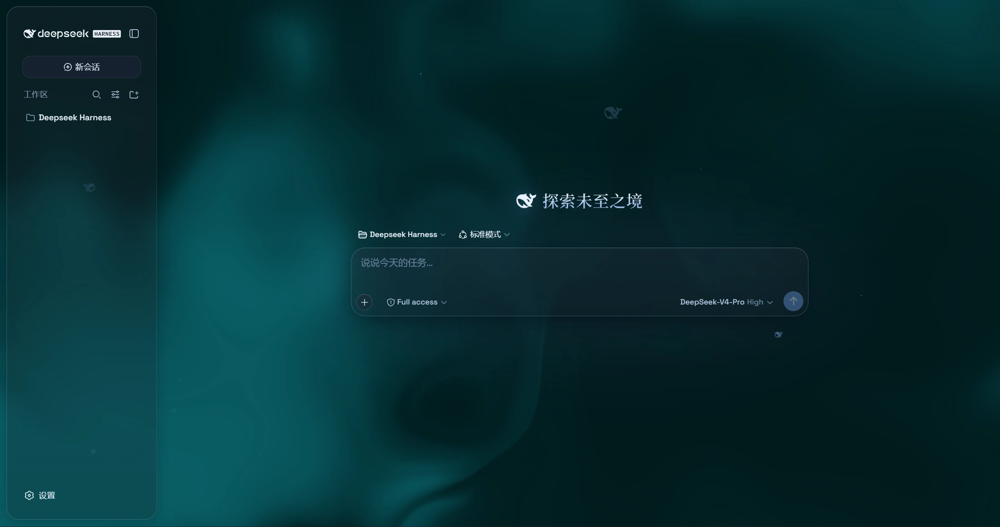
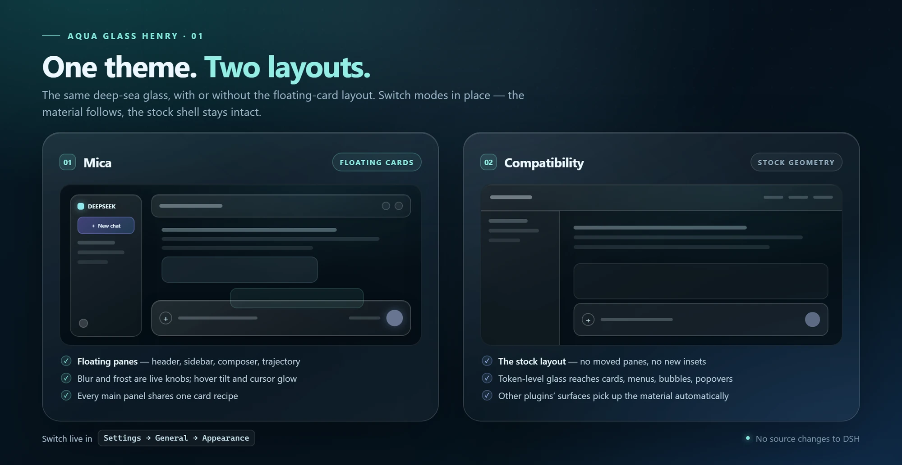
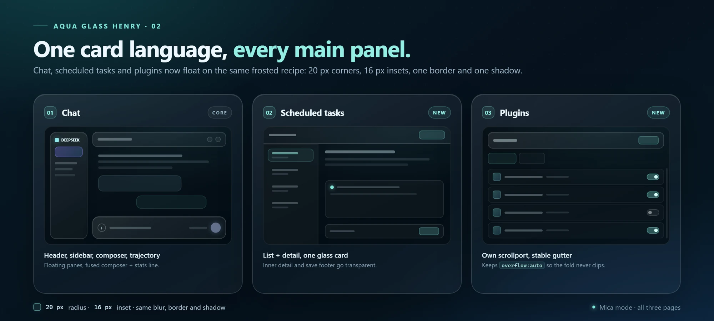
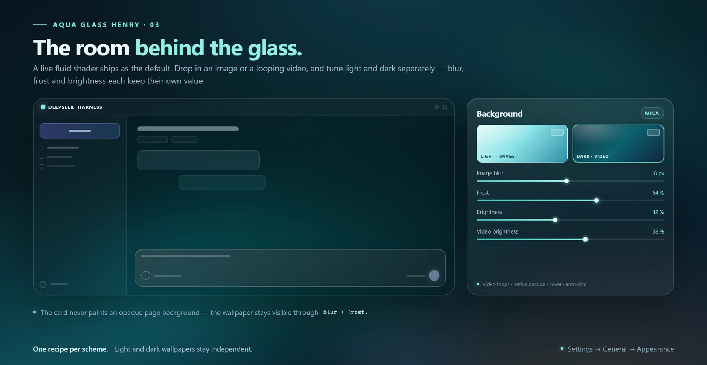
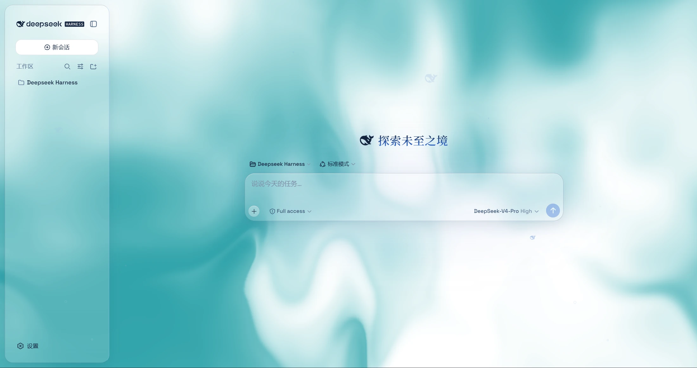
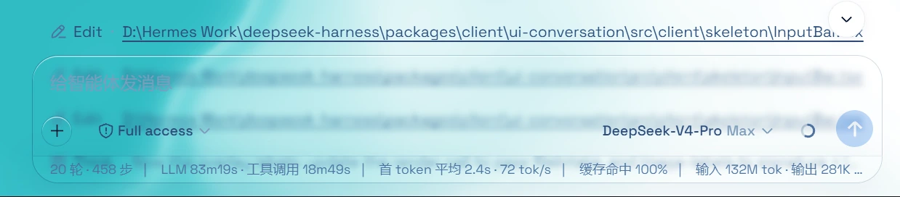
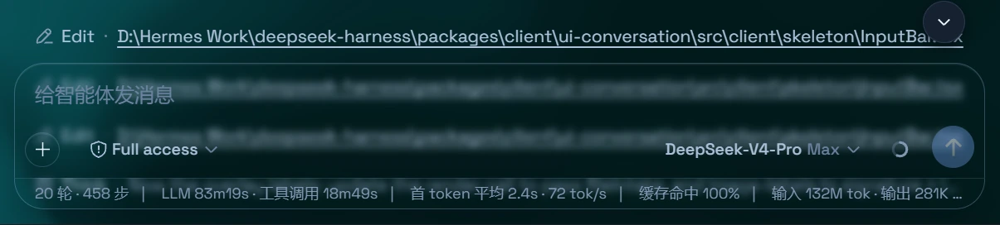

# Aqua Glass Henry

[English](README.md) | [中文](README.zh.md)

**Deep-sea glass for the DeepSeek Harness web UI.** Aqua turns the shell into floating frosted panes over a living fluid backdrop — or over your own image or video wallpaper. It is a plugin: DSH's source stays untouched, and one switch puts the stock interface back.

<p align="center">
  
  
  
  
</p>

<p align="center">
  
</p>

Aqua is a fork of [WYH66666666's Aqua v1.3.0](https://github.com/WYH66666666/DSH-Transparent-UI-Plugin), adapted for **DSH 0.2.1-rc.5**. The original material system is still here; what changed is everything needed to make it feel at home in the current Harness — and to carry the same card language into the pages the original never reached.

> **About the screenshots.** The gallery and close-ups were captured on the v1.3.0 baseline. The three diagrams are current: they show the two modes, the scheduled-tasks and plugins cards in the current build, and the per-scheme wallpaper controls. DSH's own UI copy follows your locale.

## Why this fork

Upstream v1.3.0 is the baseline. This fork keeps its look and spends the difference on the shell around it:

| Area | What changed since upstream v1.3.0 |
| --- | --- |
| **DSH 0.2.1-rc.5** | Rebuilt as a fork with its own package identity, activation patch, and General-settings row. Installation and theme-switch paths have regression tests. |
| **Desktop backdrop** | Fixed the opaque center column that hid the fluid or wallpaper behind the app. The backdrop now reaches the page edge. |
| **Wallpaper resilience** | Video loads survive theme and background switches; stale async loads are ignored; an already-authorized file can be replaced; a data-URL fallback keeps the video format. |
| **Windows chrome** | The titlebar controls stay on screen, transcript text clears the floating header, and the sidebar column no longer tilts, so fixed controls in the titlebar stay anchored. |
| **Panels** | Scheduled tasks and plugins now join the floating-card family. The plugins page keeps its own scroll container and a stable scrollbar gutter. |
| **Details** | Sidebar glass aligned with the cards, real glass on the slash-command popover, unified typography, and a white cursor glow instead of the old cyan tint. |

## Two layouts, one material

<p align="center">
  
</p>

Switch modes live in **Settings → General → Appearance**; no restart is needed.

| | Mica | Compatibility |
| --- | --- | --- |
| **Layout** | Floating cards: 20px corners, 16px inset around the shell | Stock geometry: no moved panes, no new insets |
| **Material** | The full frosted-pane recipe over the backdrop | Token-level glass applied to the stock layout |
| **Coverage** | Header, sidebar, composer + stats, trajectory, and all three main panels | Cards, menus, bubbles, popovers, toasts, the settings panel, and third-party plugin surfaces |
| **Extras** | Hover tilt and cursor glow | Conservative blur on menus, cards, bubbles, popovers, and panels |

Mica is the full treatment. Compatibility is the escape hatch for a layout-sensitive day, or for plugins that expect the stock shell.

## One card language

<p align="center">
  
</p>

All three main panels share one recipe: **20px corners, a 16px inset, a hairline border, an inset top highlight, a soft drop shadow, and backdrop blur**.

- **Chat** — header, sidebar, composer + stats, and the trajectory view float as one family.
- **Scheduled tasks** — the list and detail live inside a single glass sheet; the inner detail and save footer go transparent so the card reads as one surface.
- **Plugins** — the plugin manager gets the same card. It owns its scrollport, so it keeps `overflow: auto` and `scrollbar-gutter: stable` instead of clipping content below the fold or shifting the content column when the scrollbar appears.

## The room behind the glass

<p align="center">
  
</p>

The default backdrop is a **live fluid shader** with hue and color-depth controls. If you want your own room, switch to **Wallpaper**:

- Each scheme — light and dark — stores its own image or video, plus its own knobs.
- Image wallpapers get **blur** and **frost**; videos get **blur** and **brightness**.
- Videos use native decoding, loop, cover the page, and are dimmed automatically so text stays readable.
- A scheme without a wallpaper falls back to the fluid board. Switching Appearance swaps the backdrop immediately.
- On the first run after upgrading, an existing wallpaper is seeded into both scheme slots once, so nothing changes until you pull them apart.

Chromium can remember a video file's authorization; other browsers fall back to a stored local copy. Background brightness follows the resolved scheme: dark mode darkens from 50 down to 0, light mode brightens from 50 up to 100, and 50 is untouched.

## The look

<p align="center">
  
</p>

*Light mode uses the same material and geometry as dark mode, with a brighter fill and a pale-teal wallpaper.*

The composer and statistics line share one piece of glass, so the divider lands exactly on the rounded edge instead of splitting two different blurs:

| Light | Dark |
| :---: | :---: |
|  |  |
| <sub>Composer + stats, light</sub> | <sub>Composer + stats, dark</sub> |

## Features

| Feature | What you get |
| --- | --- |
| **Two modes** | Mica for the floating-card layout, Compatibility for the stock geometry with generic glass. |
| **Backdrop studio** | Fluid shader, image wallpaper, or video wallpaper — with per-scheme media and independent knobs. |
| **Glass everywhere** | Menus, context menus, cards, bubbles, popovers, toasts, and the settings panel. |
| **Deep-sea ambience** | A particle whale (a 2D port of the deepseek.com/harness engine), fish and bubbles, an interactive mesh, soft page-edge fades, and a glossy Harness badge in dark mode. |
| **Cursor and motion** | White cursor glow and hover tilt on the floating panes; focus rings, text selection, and `prefers-reduced-motion` are respected. |
| **Typography** | Space Grotesk with a CJK system fallback, serif headings and conversation tree, and a 14/10/8px radius language. |
| **One switch** | Turn the theme off and the stock UI comes back; uninstall removes the layer with the plugin. |
| **Tested** | Regression coverage for installation, the theme switch, backdrop selection, panel geometry, and the Windows sidebar chrome. |

## Controls

Everything lives under **Settings → General → Appearance → Glass theme**. Defaults are in parentheses; wallpaper knobs appear once media is set.

| Group | Controls |
| --- | --- |
| **Material** | Mode: Mica / Compatibility · Glass blur 0–40px (20) · Frost 0–100% (7) — blur and frost appear in Mica only |
| **Backdrop** | Fluid / Wallpaper · Hue 0–360° (320) · Color depth 0–100% (25) · Background brightness 0–50 in dark / 50–100 in light (50) |
| **Wallpaper** | One slot per scheme · image or video · image blur 0–40px and frost 0–100% · video blur 0–40px and brightness 0–100% · delete · empty falls back to fluid |
| **Ambience** | Particle whale · Fish · Interactive mesh · Cursor glow · Hover tilt — all on by default |

## Install

### Requirements

- **DSH 0.2.1-rc.5**, Desktop or Web. No other version is declared compatible.
- No build tools on the user machine: the compiled client in `lib/` is committed.
- Node.js 24 only for development.

### From DSH

1. If an older Aqua package is installed in the same profile, remove it first so two themes do not fight.
2. Open **Plugin management → Add plugin**.
3. Enter the source:

```text
github:realhenrylan/DSH-Transparent-UI-Plugin#main
```

4. Restart DSH.
5. Open **Settings → General → Appearance**, find **Glass theme**, and turn it on.

The package is named `dsh-aqua-glass-henry`. It is not published to npm; install it from the GitHub source above.

### From the CLI

Use the terminal opened from the DSH Desktop tray:

```sh
dsh plugin --profile desktop add github:realhenrylan/DSH-Transparent-UI-Plugin#main
```

For Web, replace `desktop` with `web`.

### Updating and uninstalling

Reinstall the same `#main` source and restart DSH to update. If you want a frozen build, pin a tag or commit instead of `main`. To uninstall, turn the theme off first, then remove the plugin from **Plugin management**; the injected layer and its CSS go with it.

## Use

Open **Settings → General → Appearance**. The master switch sits under **Glass theme** and stays visible when the theme is off, so you can always bring it back.

- **Mode** changes the layout treatment; **Backdrop** chooses fluid or wallpaper.
- **Wallpaper** has a separate block for light and dark. Pick the scheme you are editing, then choose an image or video.
- If a video does not start after a reload, click **Choose video** once — the host needs a fresh file grant.
- If the theme is installed but invisible, check the master switch before reinstalling.

## Compatibility

| | |
| --- | --- |
| **DSH** | 0.2.1-rc.5 only (the version declared in `package.json`) |
| **Hosts** | Desktop and Web |
| **Browsers** | Chromium recommended for video wallpapers; other browsers fall back to a stored copy |
| **Other plugins** | Compatibility mode extends the glass material to third-party surfaces |
| **Caveat** | DSH DOM changes can still move a stable hook. The theme uses the most stable seams it can, but another DSH release may need an update |

## Development

Node.js 24:

```sh
npm install
npm run build   # tsdown + declaration emit
npm run lint    # tsc --noEmit
npm test        # node:test + Vitest suites
```

The compiled `lib/` output is committed so GitHub installations do not compile on the user's machine.

A quick map:

- `src/client/theme-layer.ts` — state, lifecycle, document attributes, CSS variables.
- `src/client/aqua.module.css` — the theme layer and panel recipes.
- `src/client/AquaAppearanceRow.tsx` — the settings row and wallpaper controls.
- `src/client/wallpaper-store.ts` — per-scheme media persistence.
- `tests/` — package checks plus Vitest coverage for appearance, backdrops, panels, and Windows chrome.

## Credits

The original Aqua theme and the v1.3.0 baseline are by [WYH66666666](https://github.com/WYH66666666/DSH-Transparent-UI-Plugin). This fork is maintained by [realhenrylan](https://github.com/realhenrylan). DeepSeek Harness and the particle-whale design belong to DeepSeek. This project is not affiliated with DeepSeek.

## License

[AGPL-3.0](LICENSE), inherited from the original repository.
