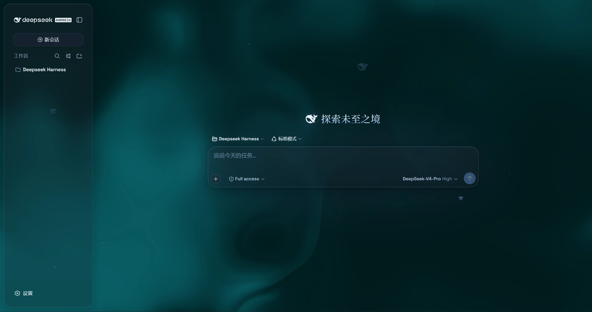
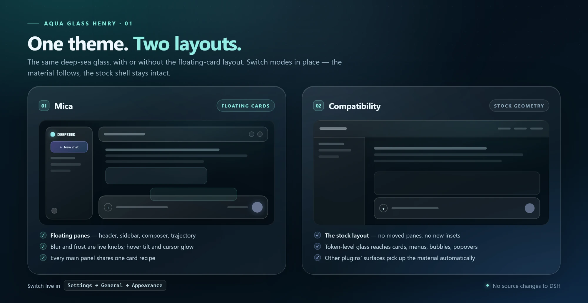
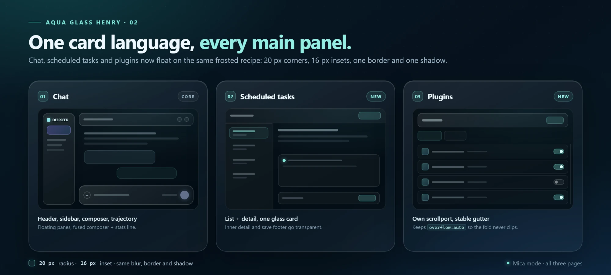
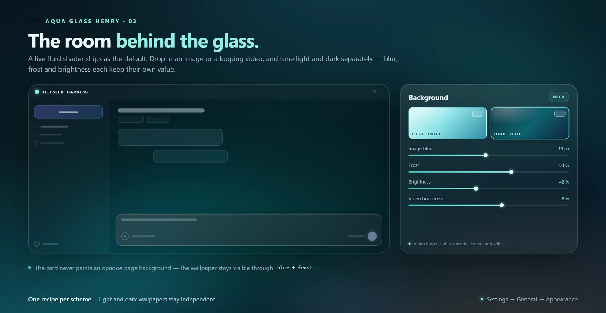
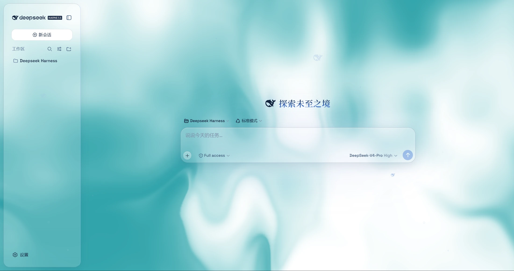
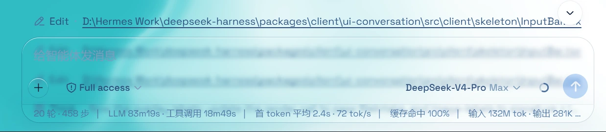
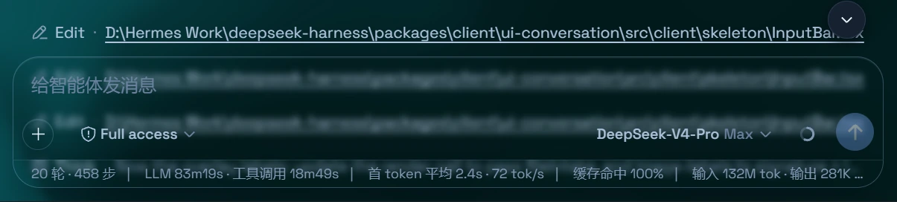

# Aqua Glass Henry

[English](README.md) | 中文

**给 DeepSeek Harness 网页端的一层深海玻璃。** Aqua 把整个界面变成浮在流体背景上的磨砂玻璃片，也可以换成你自己的图片或视频壁纸。它是一个插件：DSH 源码一行不改，关掉开关就回到原生界面。

<p align="center">
  
  
  
  
</p>

<p align="center">
  
</p>

Aqua 是 [WYH66666666 的 Aqua v1.3.0](https://github.com/WYH66666666/DSH-Transparent-UI-Plugin) 的 fork，适配 **DSH 0.2.1-rc.5**。原版的材质系统完整保留；这个 fork 改的是它在当前 Harness 里的落地方式，并把这套卡片语言带到了原版没有覆盖的页面。

> **关于截图。** 画廊和特写来自 v1.3.0 基线；三张示意图对应当前构建：两种模式、定时任务与插件页的新卡片，以及按深浅方案独立的壁纸控件。DSH 自身界面文案会跟随你的语言设置。

## 相对原版的改动

上游 v1.3.0 是基线。这个 fork 保留原有观感，把差异花在外围 shell 上：

| 方面 | 相对上游 v1.3.0 的改动 |
| --- | --- |
| **DSH 0.2.1-rc.5** | 以独立包名重建，加入激活补丁和「通用设置」入口；安装与主题切换路径有回归测试。 |
| **桌面背景** | 修复了遮住流体/壁纸的不透明中栏，背景现在铺到页面边缘。 |
| **壁纸稳定性** | 视频加载不再因切换主题或背景而丢失；过期的异步加载会被忽略；已授权的文件可以替换；data URL 兜底保留视频格式。 |
| **Windows 标题栏** | 标题栏控件不再被裁掉；正文避开悬浮顶栏；侧栏不再倾斜，固定在标题栏里的控件不会移位。 |
| **主面板** | 定时任务页和插件页加入悬浮卡片家族；插件页保留自己的滚动容器和稳定的滚动条槽。 |
| **细节** | 侧栏玻璃与卡片对齐；斜杠命令弹层换成真玻璃；字体统一；光标辉光从旧青色改为白色。 |

## 两种布局，一套材质

<p align="center">
  
</p>

在 **设置 → 通用设置 → 外观** 里即时切换，不需要重启。

| | 云母模式 | 兼容模式 |
| --- | --- | --- |
| **布局** | 悬浮卡片：20px 圆角，shell 四周 16px 内缩 | 原版几何：面板不移动，不加内缩 |
| **材质** | 完整磨砂玻璃配方，铺在背景上 | 把 token 级玻璃套在原版布局上 |
| **覆盖** | 顶栏、侧栏、输入框 + 统计行、轨迹视图、三块主面板 | 卡片、菜单、气泡、popover、toast、设置面板、第三方插件界面 |
| **额外** | 悬停下压、光标辉光 | 只对菜单、卡片、气泡、popover 和面板做保守模糊 |

云母是完整形态；兼容模式适合对布局敏感的日子，或者那些默认宿主 shell 的插件。

## 一套卡片语言

<p align="center">
  
</p>

三块主面板共用一套配方：**20px 圆角、16px 内缩、发丝边框、顶部内高光、柔和投影、背景模糊**。

- **聊天** — 顶栏、侧栏、输入框 + 统计行和轨迹视图以同一族玻璃悬浮。
- **定时任务** — 列表和详情装在同一张玻璃卡里；内部详情和保存底栏透明，整页读起来是一个表面。
- **插件** — 插件管理页使用同一张卡片。它自己就是滚动容器，所以保留 `overflow: auto` 和 `scrollbar-gutter: stable`：既不会把折叠线以下的内容裁掉，也不会在滚动条出现时让内容列左右跳动。

## 玻璃背后的房间

<p align="center">
  
</p>

默认背景是**实时流体着色器**，带色调和颜色深浅控制。如果你想要自己的房间，切换到**壁纸**：

- 浅色和深色各存一套图片或视频，也各有一套参数。
- 图片壁纸有**模糊**和**磨砂**；视频有**模糊**和**亮度**。
- 视频原生解码、循环播放、铺满页面，并自动压暗，保证文字可读。
- 某个方案没有设置壁纸时，回落到流体背景；切换外观会立即更换背景。
- 升级后的第一次运行会把已有壁纸一次性填入两套方案，所以在你把它们分开之前，界面看起来不会变。

Chromium 能记住视频文件的授权；其他浏览器会回落到一份本地存储的副本。背景亮度跟随最终生效的方案：深色从 50 往下压到 0，浅色从 50 往上提到 100，50 保持原样。

## 界面

<p align="center">
  
</p>

*浅色模式使用与深色相同的材质和几何，只是填充更亮，并配一张淡青色壁纸。*

输入框和统计行共用一块玻璃，所以分隔线正好落在圆角边缘上，而不是把两种不同的模糊拼在一起：

| 浅色 | 深色 |
| :---: | :---: |
|  |  |
| <sub>输入框 + 统计行，浅色</sub> | <sub>输入框 + 统计行，深色</sub> |

## 特性

| 特性 | 你会得到什么 |
| --- | --- |
| **双模式** | 云母模式是悬浮卡片布局；兼容模式保留原版几何，只加通用玻璃。 |
| **背景工作台** | 流体着色器、图片壁纸或视频壁纸；深浅方案独立存放媒体和参数。 |
| **处处玻璃** | 菜单、上下文菜单、卡片、气泡、popover、toast、设置面板。 |
| **深海氛围** | 粒子鲸鱼（deepseek.com/harness 粒子引擎的 2D 移植）、小鱼和气泡、网状交互、页面上下边缘渐隐、深色模式下的光泽 Harness 铭牌。 |
| **光标与动效** | 悬浮面板上的白色光标辉光和悬停下压；保留焦点环、文本选中和 `prefers-reduced-motion`。 |
| **字体** | Space Grotesk（西文）+ 衬线中文（Noto Serif SC、宋体/STSong/SimSun）；标题和会话树同为衬线；圆角层级 14/10/8px。 |
| **一个开关** | 关闭后回到原生界面；卸载插件会一并移除注入层。 |
| **有测试** | 覆盖安装、主题开关、背景选择、面板几何和 Windows 标题栏/侧栏适配。 |

## 调节项

全部位于 **设置 → 通用设置 → 外观 → 玻璃主题**。括号内是默认值；壁纸参数在选好媒体后出现。

| 分组 | 控件 |
| --- | --- |
| **材质** | 模式：云母效果 / 兼容模式 · 玻璃模糊度 0–40px（20）· 磨砂度 0–100%（7）——模糊度和磨砂度只在云母模式显示 |
| **背景** | 流体 / 壁纸 · 色调 0–360°（320）· 颜色深浅 0–100%（25）· 背景亮度 深色 0–50 / 浅色 50–100（50） |
| **壁纸** | 每个方案一套 · 图片或视频 · 图片模糊度 0–40px、磨砂度 0–100% · 视频模糊度 0–40px、亮度 0–100% · 删除 · 留空回落到流体 |
| **氛围** | 粒子鲸鱼 · 小鱼 · 网状交互 · 鼠标辉光 · 悬停下压——默认全开 |

## 安装

### 要求

- **DSH 0.2.1-rc.5 或更新、低于 0.3.0**（manifest 声明 `>=0.2.1-rc.5 <0.3.0-0`），Desktop 或 Web。已在 0.2.1-rc.5 上安装验证。
- 用户机器不需要构建工具：`lib/` 里的编译结果随仓库提交。
- 只有开发时才需要 Node.js 24。

### 从 DSH 安装

1. 如果同一个配置里装过旧 Aqua 包，先卸载，避免两个主题打架。
2. 打开 **插件管理 → 添加插件**。
3. 填入来源：

```text
github:realhenrylan/DSH-Transparent-UI-Plugin#4602dd811c0ab12ada59a829d8c30d658198c34a
```

4. 重启 DSH。
5. 打开 **设置 → 通用设置 → 外观**，找到 **玻璃主题** 并开启。

包名是 `dsh-aqua-glass-henry`。它没有发布到 npm，请用上面的 GitHub 来源安装。来源固定在具体 commit，`main` 被推送也不会悄悄改变你运行的代码；每次经过验证的构建会刻意更新这个固定点。想自行安装其他版本，把固定点换成 tag 或别的 commit SHA。

### 从 CLI 安装

在 DSH Desktop 托盘打开的终端中运行：

```sh
dsh plugin --profile desktop add github:realhenrylan/DSH-Transparent-UI-Plugin#4602dd811c0ab12ada59a829d8c30d658198c34a
```

Web 版把 `desktop` 换成 `web`。

### 更新与卸载

重新安装同一个固定来源并重启 DSH 即可更新；仓库发布新的验证构建后，把固定点移到新 commit（或自己临时换成 `#main` 跟踪分支，但需要接受推送可能改变运行内容）。卸载前先关闭主题，再从 **插件管理** 移除；注入层和它的 CSS 会随插件一起消失。

## 使用

打开 **设置 → 通用设置 → 外观**。总开关在 **玻璃主题** 下，主题关闭时仍然显示，随时可以再打开。

- **模式** 改变布局处理；**背景** 选择流体或壁纸。
- **壁纸** 分浅色和深色两块。先选正在编辑的方案，再选图片或视频。
- 视频刷新后如果不会自动播放，点一次 **选择视频**——宿主需要重新授权文件。
- 主题装了却看不到效果，先检查总开关，不要急着重装。

## 兼容性

| | |
| --- | --- |
| **DSH** | 仅 0.2.1-rc.5（以 `package.json` 声明为准） |
| **宿主** | Desktop 和 Web |
| **浏览器** | 视频壁纸推荐 Chromium；其他浏览器会回落到本地存储副本 |
| **其他插件** | 兼容模式会把玻璃材质扩展到第三方界面 |
| **注意** | DSH 的 DOM 变化仍可能移动主题依赖的稳定钩子。主题尽量使用最稳定的接缝，但下一个 DSH 版本可能仍需要适配 |

## 开发

Node.js 24：

```sh
npm install
npm run build   # tsdown + 声明文件
npm run lint    # tsc --noEmit
npm test        # node:test + Vitest
```

编译后的 `lib/` 随仓库提交，所以 GitHub 安装不会在用户机器上编译。

快速地图：

- `src/client/theme-layer.ts` — 状态、生命周期、document 属性、CSS 变量。
- `src/client/aqua.module.css` — 主题层和面板配方。
- `src/client/AquaAppearanceRow.tsx` — 设置行和壁纸控件。
- `src/client/wallpaper-store.ts` — 按方案持久化媒体。
- `tests/` — 包检查，以及外观、背景、面板、Windows 标题栏的 Vitest 覆盖。

## 致谢

原版 Aqua 主题和 v1.3.0 基线由 [WYH66666666](https://github.com/WYH66666666/DSH-Transparent-UI-Plugin) 制作；这个 fork 由 [realhenrylan](https://github.com/realhenrylan) 维护。DeepSeek Harness 和粒子鲸鱼设计归 DeepSeek 所有。本项目与 DeepSeek 没有隶属关系。

## 许可

[AGPL-3.0](LICENSE)，继承自原仓库。

[](https://github.com/deepseek-ai/deepseek-harness)
